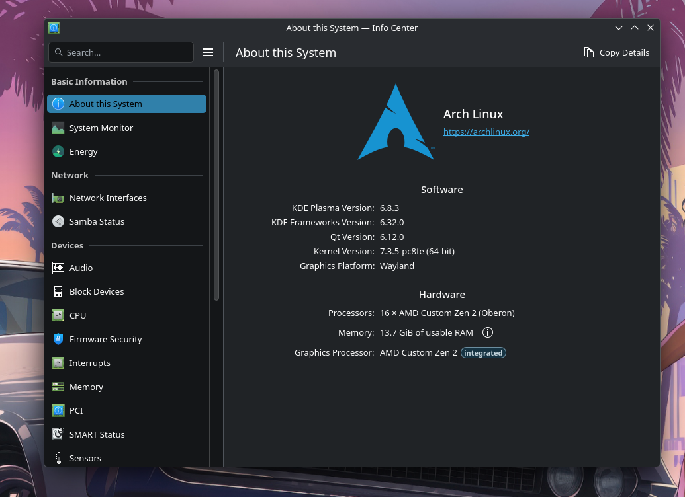
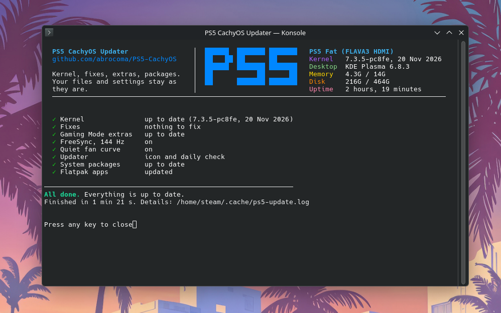
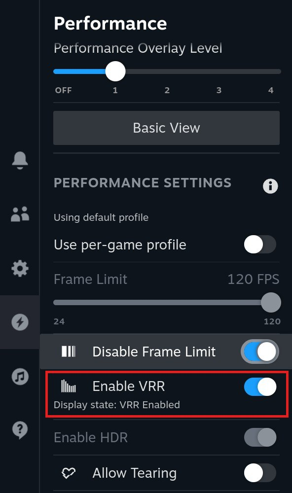
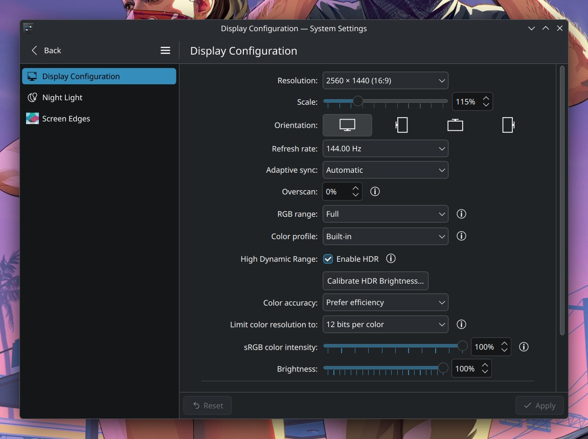

# CachyOS on PS5

> [!NOTE]
> **This is MastaG's fork of [abrocoma/PS5-CachyOS](https://github.com/abrocoma/PS5-CachyOS).** Its image is
> upstream's image on **btrfs** (CachyOS subvolume layout, snapper), with the GFX1013 compute kernel
> `7.3.5-pc8fe-bc1`, the BC-250 Mesa, swap file + zswap, a smoother fan curve, boost as an opt-in, the
> emulator repo (nothing installed), Gaming Mode on every boot and an installer for the internal M.2.
> What exactly differs: [image/README.md](image/README.md). Tested on a **PS5 Pro** (firmware 11.60).

**Run a full Linux desktop and Steam on a jailbroken PS5.** Flash a ready-made image to a USB SSD, boot it, play.




**This fork is tested on** a PS5 Pro, firmware 11.60, with the loader from this repo's release ([below](#the-loader)). **Upstream's image is tested on** a PS5 launch model Digital Edition (CFI-1016B), firmware 13.60, [soniciso1's ps5-linux-loader](https://github.com/soniciso1/ps5-linux-loader/releases), a 1 TB USB-C SSD, a 1440p 144 Hz monitor and a 4K 60 Hz TV. The image is built on the official [ps5-linux CachyOS image](https://github.com/ps5-linux/ps5-linux-image), see [Credits](#credits).

> [!IMPORTANT]
> **Rebooting Linux takes you back to PS5 OS.** To get into Linux again, run the exploit and the loader again.

## Contents

0. [What this fork changes](#what-this-fork-changes)
1. [Flash the image](#1-flash-the-image)
2. [Boot into Linux](#2-boot-into-linux) (and [the loader](#the-loader), [autoloading it from USB](#optional-autoload-the-loader-from-the-usb-ssd))
3. [First boot and getting online](#3-first-boot-and-getting-online)
4. [Gaming Mode and the desktop](#4-gaming-mode-and-the-desktop)
5. [Updating](#5-updating) (and [snapshots](#snapshots))
6. [Display, FreeSync and HDR](#6-display-freesync-and-hdr)
7. [Extras: boost, fan and video](#7-extras-boost-fan-and-video)
8. [Emulators](#8-emulators) (and [Proton with FSR 4](#proton-with-fsr-4))
9. [AI and GPU compute](#9-ai-and-gpu-compute)
10. [Installing to the internal M.2](#10-installing-to-the-internal-m2)
11. [Troubleshooting](#11-troubleshooting)

[Advanced](docs/advanced.md): the official image, building your own kernel, what's in this repo.

---

## What this fork changes

Everything upstream's image has is still in this one (Gaming Mode, HDR, FreeSync, Wi-Fi, the updater). On top:

| | Upstream ([abrocoma/PS5-CachyOS](https://github.com/abrocoma/PS5-CachyOS)) | This fork |
|---|---|---|
| **File system** | ext4 | **btrfs** with CachyOS's subvolumes (`@`, `@home`, `@root`, `@srv`, `@cache`, `@log`, `@tmp`), zstd compression, **snapper** snapshots before and after every pacman run, btrfs Assistant |
| **Kernel** | 7.3.5-pc8fe | **7.3.5-pc8fe-bc1**: the same kernel plus the GFX1013 **amdgpu/KFD fixes** of linux-cachyos-bc250 (`patches/0008`-`0016`), which make GPU compute reliable: [KytyPS5-Native](#8-emulators) and [AI/LLM work](#9-ai-and-gpu-compute) (llama.cpp, ComfyUI, ROCm). |
| **Kernel command line** | | the BC-250's compute settings (`ttm.pages_limit`, `amdgpu.sched_policy=2`, `cwsr_enable=0`, `vm_update_mode=0`, `bc250_gfx_eop_events=2`) and zswap |
| **Mesa** | Arch's | the BC-250 Mesa from `[bc250-cachyos]`: built for Zen 2, GFX1013 compute queue fix, FSR 4 support. Mesh shaders (DirectMesh) stay off on the PS5: they hang the PS5 Pro's GPU in Vulkan CTS |
| **Swap** | zram | a swap file in its own subvolume (32 GB on a 128 GB+ drive) with zswap in front |
| **Gaming Mode** | boots the mode used last | boots **Gaming Mode every time**; Steam runs as a user service, so KytyPS5 can close Steam while a game runs and bring it back |
| **Desktop** | | Steam starts in the background with the desktop |
| **Emulators** | | the [bc250-emulators](https://github.com/MastaG/bc250-emulators) repo is set up (nothing installed): KytyPS5-Native, Lichii, with Steam shortcuts in collections |
| **Proton** | | the [FSR 4 Proton builds](docs/PROTON.md) are available from `[bc250-cachyos]` |
| **Boost** | an `install.sh` extra | `sudo ps5-boost on` / `off`, off by default |
| **Fan** | quiet curve | a smoother curve: upstream's is so quiet up to 65 °C (PWM 5-31) that under load the fan jumps from nearly silent to loud every few seconds; this one starts higher (PWM 40 at 50 °C) and rises evenly |
| **Internal M.2** | | `sudo ps5-install-m2` |
| **Loader** | soniciso1's releases | the same loader built from his main branch with [PR #31](https://github.com/soniciso1/ps5-linux-loader/pull/31) (PS5 Pro pairing export), until he releases it ([the loader](#the-loader)) |
| **Other** | | NTP clock sync on, `steam` in the `render` group, git preinstalled (gcc is installed when boost or the M.2 installer needs it), updates from this fork |

**PS5 Pro Bluetooth** (internal adapter, DualSense, pairings from PS5 OS) works in both: those fixes were made here and are part of upstream's image too. The full list of files the build changes: [image/README.md](image/README.md).

## 1. Flash the image

Linux runs entirely from an external SSD. Nothing is installed on the PS5's internal storage.

**You need:** a jailbroken PS5, the Linux loader ([below](#the-loader)) and a USB 3 SSD. 128 GB or more gets the full 32 GB swap file; smaller drives (even a 32 GB stick) work with a smaller one.

> [!NOTE]
> Upstream's [Linux Flasher](https://github.com/abrocoma/PS5-Linux-Flasher/releases/latest) payload flashes **upstream's** image, not this one. Flash this image from a PC.

> [!CAUTION]
> Flashing **erases the whole SSD**.

**Download** `ps5-cachyos-7.3.5-pc8fe-bc1-btrfs-20261121.img.xz` (3 GB) from the [latest release](https://github.com/MastaG/PS5-CachyOS/releases/latest). It's upstream's image (every fix of this guide: no black screens at 1080p/1440p, up to 144 Hz, FreeSync, desktop HDR, SteamOS-style Gaming Mode, Wi-Fi, DualSense reconnect, one-click updater) on btrfs, with this fork's kernel, Mesa and extras.

```sh
wget https://github.com/MastaG/PS5-CachyOS/releases/download/image-2026-11-21/ps5-cachyos-7.3.5-pc8fe-bc1-btrfs-20261121.img.xz
wget https://github.com/MastaG/PS5-CachyOS/releases/download/image-2026-11-21/ps5-cachyos-7.3.5-pc8fe-bc1-btrfs-20261121.img.xz.sha256
sha256sum -c ps5-cachyos-7.3.5-pc8fe-bc1-btrfs-20261121.img.xz.sha256     # must say OK
```

**Flash it:**
- **Windows / macOS:** extract the `.img.xz` to get the `.img` (Windows: [7-Zip](https://www.7-zip.org/); macOS: double-click it), then flash it with [balenaEtcher](https://etcher.balena.io/).
- **Linux:** find the SSD with `lsblk` and write to the **whole disk** (`/dev/sdX`, not `/dev/sdX1`):
  ```sh
  xzcat ps5-cachyos-7.3.5-pc8fe-bc1-btrfs-20261121.img.xz | sudo dd of=/dev/sdX bs=4M status=progress conv=fsync
  ```

## 2. Boot into Linux

**Plug the SSD into** the **front USB-C port** or a **rear USB 3.0 port**. Not the front USB-A port: it's only USB 2.0.

> [!WARNING]
> **Don't run any other payloads before the Linux loader** (homebrew, FTP, cheats). The loader crashes if anything else is loaded. Start from a fresh boot every time.

1. **Turn on** (or restart) the PS5.
2. **Run your exploit** (Y2JB, Relapse, etc.).
3. **Load only the ps5-linux-loader payload.**
4. The PS5 **goes into rest mode** by itself. Wait until the power light **stops pulsing and stays solid orange**.
5. **Press the power button.** It boots into Linux.

Crashed or frozen? Restart the PS5 and start again from step 1. Stuck at "waiting for device"? See [Drive not found](#drive-not-found-at-boot).

### The loader

Use **`ps5-linux-loader-18e3757.elf`** from this repo's [release](https://github.com/MastaG/PS5-CachyOS/releases/latest). It's [soniciso1's ps5-linux-loader](https://github.com/soniciso1/ps5-linux-loader) built from commit [`18e3757`](https://github.com/soniciso1/ps5-linux-loader/commit/18e37570fd72f2bce41978ca7740ed8db337098e), which has the PS5 Pro Bluetooth work merged from [#31](https://github.com/soniciso1/ps5-linux-loader/pull/31): it exports the controllers paired in PS5 OS, so they work in Linux without pairing again. soniciso1 hasn't put out a release with it yet; once he has, his [releases](https://github.com/soniciso1/ps5-linux-loader/releases) work the same. It's GPL-3.0, that commit is its source; the build is described in [image/README.md](image/README.md#loader). Check the download:

```sh
sha256sum -c ps5-linux-loader-18e3757.elf.sha256     # must say OK
```

### Optional: autoload the loader from the USB SSD

If your exploit's autoloader runs payloads from a USB drive (as with Y2B), you don't need to send the loader by hand every time. On the SSD's **`boot`** partition (FAT32, any PC can open it), create a folder **`ps5_autoloader`** with:

- `ps5-linux-loader-18e3757.elf`
- `autoload.txt`, containing one line: the name of the ELF

```
boot/
└── ps5_autoloader/
    ├── autoload.txt          ->  ps5-linux-loader-18e3757.elf
    └── ps5-linux-loader-18e3757.elf
```

On Linux, with the SSD plugged into the PC (`boot` mounted, for example at `/run/media/$USER/boot`):

```sh
B=/run/media/$USER/boot
mkdir -p "$B/ps5_autoloader"
cp ps5-linux-loader-18e3757.elf "$B/ps5_autoloader/"
echo ps5-linux-loader-18e3757.elf > "$B/ps5_autoloader/autoload.txt"
sync
```

From Linux on the PS5 itself, the same partition is mounted at `/boot/efi` (use `sudo`). The image doesn't ship the folder: add it after flashing.

## 3. First boot and getting online

On first boot the system partition **grows to fill the SSD**, a **swap file** is made (32 GB on a 128 GB+ drive, 8 or 4 GB on smaller ones), a **setup screen** asks for timezone, hostname and password, then **Gaming Mode** starts. The clock is set over the internet (NTP).

The default login is **`steam`** / **`steam`**, hostname `ps5`.

> [!WARNING]
> **Change the password** (*Customize* in the setup screen, or `passwd` later). SSH with password login is on.

**Ethernet** works straight away. **Wi-Fi:** Steam → **Settings → Internet** in Gaming Mode, or the network icon on the desktop. It reconnects on its own at every boot.

> [!TIP]
> **No picture or need a terminal?** Plug in a USB keyboard, press <kbd>Ctrl</kbd>+<kbd>Alt</kbd>+<kbd>F2</kbd> and log in as `steam`. <kbd>Ctrl</kbd>+<kbd>Alt</kbd>+<kbd>F1</kbd> goes back. Wi-Fi from there: `nmtui`.

## 4. Gaming Mode and the desktop

The PS5 boots into **Gaming Mode** every time: Steam's console interface, as on SteamOS. **Switch to Desktop** lasts until the next restart. On the desktop, Steam starts by itself in the background (system tray).


- **To the desktop:** Steam's power menu → **Switch to Desktop**. **Back:** the **Return to Gaming Mode** icon on the desktop.
- **Quick menu** (performance overlay, frame limit, FreeSync): <kbd>Ctrl</kbd>+<kbd>Shift</kbd>+<kbd>Tab</kbd>, also in a game. See [FreeSync in Gaming Mode](#freesync-in-gaming-mode).
- **Display and network settings** are in Steam's settings, as on a Steam Deck.
- **Steam's Restart** is a real reboot, so it takes you back to PS5 OS.
- **Always boot to the desktop instead:** `echo plasma > ~/.config/ps5-boot-session` (`gamescope` for Gaming Mode, the default). Delete that file to boot into the mode you used last, as upstream does.
- **Don't want Steam on the desktop?** `sudo rm /etc/xdg/autostart/steam.desktop`.


## 5. Updating

Click **Update PS5 CachyOS** on the desktop (switch to the desktop first). Steam's own "up to date" message doesn't cover the system. In this fork it updates from this repo: the **7.3.5-pc8fe-bc** kernel line, this fork's fan curve, and system packages including the BC-250 Mesa from linux-cachyos-bc250. Every package update is a [snapshot](#snapshots) you can go back to.

On an older install without that icon, run this once on the desktop as your normal user (**without** `sudo`):

```
curl -fsSL https://raw.githubusercontent.com/MastaG/PS5-CachyOS/main/scripts/update.sh | sh
```



It updates, in order: the **PS5 kernel**, **fixes**, the **Gaming Mode and Steam extras**, **FreeSync and 1080p 144 Hz** (asks), the **fan curve** (asks, default no), the **update icon** with a daily check for new kernels, and finally **all system packages and Flatpak apps** (asks). Restart afterwards if the kernel changed.

**Undo:** the same line with `| sh -s -- --rollback` at the end. Package updates can't be undone.

<details>
<summary>Single steps and what they change</summary>

- **Kernel only:** `curl -fsSL https://raw.githubusercontent.com/MastaG/PS5-CachyOS/main/scripts/update-kernel.sh | sudo sh`. Replaces `/boot/efi/bzImage` + `initrd.img` (old ones kept as `.bak`) and the modules, incl. the Wi-Fi driver. FreeSync and 1080p 144 Hz also need `hdmi.vrr=1 hdmi.extended_tmds=1` in `cmdline.txt`. Booting from USB with root on an M.2 drive works too.
- **Gaming Mode and Steam extras only:** `curl -fsSL https://raw.githubusercontent.com/MastaG/PS5-CachyOS/main/scripts/update-extras.sh | sudo sh`. Stops Steam from "updating" on every switch between Gaming Mode and the desktop, adds the performance overlay, makes shader pre-caching use all 16 threads, lets you pick the refresh rate in Steam's own display settings, turns on HDR in Gaming Mode (PS5 Fat), and adds the **12-bit Colour** icon. Changed files are kept as `.bak-extras`; a launcher you edited yourself is left alone (`--force` replaces it).
- **Kernel headers** (to build extra drivers with DKMS, e.g. `xone` for the Xbox Wireless Adapter): `curl -fsSL https://raw.githubusercontent.com/MastaG/PS5-CachyOS/main/scripts/update-kernel.sh | sudo sh -s -- --headers`. Puts the build files at `/usr/lib/modules/<kernel>/build` and builds your DKMS drivers. Later kernel updates install new headers by themselves.
- **Undo** each one: the same line with `| sudo sh -s -- --rollback` at the end.
</details>

### Snapshots

The image is on btrfs with **snapper**: every `pacman` run (also the updater's package step) makes a snapshot before and after. They live on the same drive and are cleaned up automatically (up to 50).

- **See them:** `sudo snapper list`, or **btrfs Assistant** on the desktop.
- **Go back:** btrfs Assistant → **Snapper** → pick the snapshot → **Restore**, then restart. The PS5 loader has no boot menu, so restore from the running system (or from tty2 if the desktop doesn't start).
- **Space:** `sudo compsize /` shows how much zstd compression saves.

## 6. Display, FreeSync and HDR

| Mode | Status |
|---|---|
| 1080p @ 60 / 120 / 144 Hz | ✅ (144 Hz needs a monitor that offers it) |
| 1440p @ 60 / 120 / 144 Hz | ✅ |
| 2160p @ 60 Hz | ✅ |
| 75 Hz and other monitor modes (e.g. 1080p @ 75 Hz) | ✅ with kernel 7.3.5-pc8fe or newer |
| 2160p @ 120 Hz | Needs an HDMI 2.1 TV (untested) |

**FreeSync / VRR** works at **60 and 120 Hz**, not at 144 Hz (the PS5's HDMI chip doesn't do variable refresh there). First turn on **Adaptive-Sync / FreeSync** in the monitor's own menu. For fast games that already run above 144 fps (CS2, for example), fixed 144 Hz usually feels better.

- **Desktop:** pick 60 or 120 Hz, then **System Settings → Display → Adaptive sync:** *Automatic*.

### Refresh rate in Gaming Mode

Steam **Settings → Display** lists your screen's resolutions and refresh rates (for example 1440p at 60 / 120 / 144 Hz). The change is live, and Steam remembers it per screen. Games read the refresh rate when they start, so a game that's already running shows the new value in its own settings after a restart.

### FreeSync in Gaming Mode

1. In Gaming Mode: Steam **Settings → Display** → pick **120 Hz** (or 60 Hz).
2. Quick menu (<kbd>Ctrl</kbd>+<kbd>Shift</kbd>+<kbd>Tab</kbd>) → **Performance** (lightning icon) → **Enable VRR**.
3. To check it: set a **Frame Limit** below 120 (turn off **Disable Frame Limit** first). The monitor's info menu then shows **AMD FreeSync** and a refresh rate that follows the game.

The same menu has the **Performance Overlay Level** (fps, CPU/GPU load, temperatures). The frame limit wins over a higher in-game limit such as `fps_max` in CS2.



### HDR and colour

**Desktop HDR:** **System Settings → Display → Enable HDR**. HDR at 4K needs 12-bit colour: click the **12-bit Colour** icon. 

**HDR in Gaming Mode** (PS5 Fat and Pro / FLAVA3): turn on HDR in the monitor's menu if it has a setting for it, then quick menu → **Performance** → **Enable HDR**. Steam's SDR brightness slider works too. The PS5 Slim keeps sRGB output without HDR, because HDR signalling gives a black screen on its HDMI chip.

**HDMI chip:** check yours with `sudo dmesg | grep "HDMI IC"`. **FLAVA3** (launch model) does HDR and 12-bit colour. **VERDE** (Slim) is limited to 8-bit colour without HDR.



## 7. Extras: boost, fan and video

**Boost** (CPU up to 3.5 GHz instead of 3.2, GPU up to 2.23 GHz on the Pro) is **off** by default. It needs internet once:

```sh
sudo ps5-boost on       # builds ps5_control from ps5-linux-tools the first time, stays on after a restart
sudo ps5-boost off      # back to normal clocks, stays off
ps5-boost status
```

The fan curve stays in charge with boost on (the SoC sits around 73 °C in heavy games on a Pro).

**`install.sh`** checks the core fixes (all in the image) and offers extras: **Wi-Fi driver** reinstall, **Cloudflare DNS** and **boot to desktop**. Use `ps5-boost` for boost.

```sh
git clone https://github.com/MastaG/PS5-CachyOS
cd PS5-CachyOS
sudo ./install.sh        # -y installs every extra
```

**Fan:** the image runs a smooth fan curve (it rises gradually, no jumps from silent to loud) and shows "SoC Temp" in the panel. Back to the kernel's default curve: `curl -fsSL https://raw.githubusercontent.com/MastaG/PS5-CachyOS/main/scripts/quiet-fan.sh | sh -s -- --remove`. Don't run ps5-linux-tools' `ps5fan` service with it: it pins the fan loud.

<details>
<summary>Changing the fan curve</summary>

8 points in the `ps5_fan` hwmon folder: `pwm1_auto_point1..8_temp` (millidegrees) and `pwm1_auto_point1..8_pwm` (0-255, the last must be 255). The firmware still forces full speed at 90 °C. The image's curve (`/usr/local/sbin/ps5-fan-curve`):

| °C | 50 | 55 | 60 | 65 | 70 | 75 | 80 | 88 |
|---|---|---|---|---|---|---|---|---|
| PWM | 40 | 50 | 60 | 72 | 85 | 100 | 125 | 255 |

Values reset at every boot. Only lower the curve if your console's cooling is in good shape.
</details>

**Video:** Firefox and Chrome use hardware video decode. The APU has **no AV1 decode**, so use the enhanced-h264ify extension for YouTube. KDE can't show GPU load; use `nvtop`.

## 8. Emulators

The image has the **[bc250-emulators](https://github.com/MastaG/bc250-emulators)** package repo set up, with nothing installed. It has emulators built and tuned for the PS5's and BC-250's GPU (GFX1013), for **your own** game dumps:

```sh
sudo pacman -S kytyps5-native-git     # PS5 games (KytyPS5-Native)
sudo pacman -S lichii-bc250           # Switch 2 games (Lichii)
```

Each comes with a script that adds your games to Steam as shortcuts, with their artwork, and puts them in a **collection** ("PlayStation 5" or "Switch 2"):

```sh
kytyps5-steam-sync          # game folders in ~/Games/PS5 (each with eboot.bin and sce_sys/param.json)
lichii-steam-sync           # game files in ~/Games/Switch2
```

Run them again after adding or removing games (`--dry-run` shows what would change). They stop and restart Steam to write its shortcut list. In Gaming Mode, KytyPS5 closes Steam while a game runs (more memory for the game) and brings it back when the game ends. See the [bc250-emulators README](https://github.com/MastaG/bc250-emulators) for the settings of each emulator.

### Proton with FSR 4

The `[bc250-cachyos]` repo has three Proton builds with **FSR 4** ready to use: `proton-cachyos-native-bc250` (fastest, no anti-cheat games), `proton-cachyos-slr-bc250` (Steam Linux Runtime, anti-cheat games) and `protonge-latest-bc250` (GE-Proton):

```sh
sudo pacman -S proton-cachyos-native-bc250 proton-cachyos-slr-bc250 protonge-latest-bc250
```

Don't install `linux-cachyos-bc250-meta`: it pulls in the BC-250 kernel, which doesn't boot on a PS5. Restart Steam, then pick one under a game's **Properties → Compatibility**. Launch options, the upscaler menu, per-game settings and the anti-cheat caveats: **[docs/PROTON.md](docs/PROTON.md)** (how they're built: [docs/FSR4-PROTON.md](docs/FSR4-PROTON.md)).

## 9. AI and GPU compute

The kernel carries the GFX1013 compute (KFD) fixes made for the BC-250 board (same GPU family; `patches/0008`-`0016`, [KERNEL-SOURCE.md](kernel/KERNEL-SOURCE.md)), and the image ships the BC-250 Mesa. The BC-250's AI guides therefore apply here, copied into this repo with notes where the PS5 differs:

- **[Local AI](docs/AI.md)**: chat with llama.cpp (Vulkan) and images with ComfyUI.
- **[ROCm / KFD support](docs/ROCM.md)**: why the patches are needed, ROCm and the `bc250-pytorch` package (from the `[bc250-cachyos]` repo the image already has).
- **[AI benchmarks](docs/AI-BENCHMARKS.md)**: what was measured on the BC-250, and what else was tried.
- **Measured on the PS5 Pro:** [Inkling-2-Mini](docs/AI.md#faster-chat-inkling-2-mini), a 26B mixture-of-experts model, reads prompts at 686 tokens/s and writes 59 tokens/s with a llama.cpp fork (Vulkan).

What's different on the PS5:

- **Kernel parameters:** `ttm.pages_limit=3670016` and `amdgpu.sched_policy=2` are already in this image's `cmdline.txt`. The `steam` user is in the `render` group (`/dev/kfd`).
- **No CU unlock:** `amdgpu.bc250_cc_write_mode` / `bc250_cc_wgp_mask` are BC-250 only and not in this kernel.
- **Numbers:** the guide's benchmarks are BC-250 measurements (Inkling-2-Mini was measured on the PS5 Pro too); the PS5's clocks, CU count and memory differ ([boost](#7-extras-boost-fan-and-video) helps). The PS5 Pro gives Linux about 15 GiB of memory, shared by the CPU and GPU, so the guide's "one at a time" applies here too: stop Gaming Mode before loading a big model ([how](docs/AI.md#before-you-start-server-mode)).

## 10. Installing to the internal M.2

The system can run from the PS5's internal M.2 SSD instead of USB: faster, and the USB SSD is then only the boot drive.

> [!CAUTION]
> This **erases the whole M.2**, including PS5 games stored on it.

1. Flash and boot the image from USB as above, and get online (it downloads `m2_init` from ps5-linux-tools).
2. On the desktop (Konsole) or over SSH:
   ```sh
   sudo ps5-install-m2
   ```
   It shows the M.2 and asks you to type `ERASE`. It then partitions the M.2 the way PS5 OS expects (`m2_init`), creates the same btrfs layout (label `cachyos-m2`) and copies the running system to it.
3. Restart. The loader still starts from the **USB SSD**: its `boot` partition keeps `bzImage`, `initrd.img` and `cmdline.txt`, which now says `root=LABEL=cachyos-m2`. **Keep the USB SSD plugged in.** On the first M.2 boot the swap file is made again (32 GB on a big M.2).

**Back to the USB system:** `sudo ps5-install-m2 --usb-root` (restores `cmdline.txt.usb-root`), then restart. The kernel updater handles a USB boot partition with an M.2 root.

## 11. Troubleshooting

### Black screen

The GPU sends DisplayPort to an internal DP→HDMI bridge, which loses sync if the link speed drops. The image locks the link at boot, so this mostly happens on first boot, after a resolution change or after replugging the cable. Try in order:

1. **Switch TTYs** with a USB keyboard: <kbd>Ctrl</kbd>+<kbd>Alt</kbd>+<kbd>F2</kbd>, wait 3 seconds, <kbd>Ctrl</kbd>+<kbd>Alt</kbd>+<kbd>F1</kbd>. Repeat once or twice.
2. **Switch the TV input** away and back.
3. **Re-lock the link** from tty2 (log in blind) or over SSH (`ssh steam@ps5`):
   ```sh
   echo "4 0x1e" | sudo tee /sys/kernel/debug/dri/0/DP-1/link_settings
   echo 1 | sudo tee /sys/kernel/debug/dri/0/DP-1/trigger_hotplug
   ```
   Still black? Run the second line again a few seconds later. With this repo on the PS5, `sudo ./scripts/fix-black-screen.sh` does it all.

A few `CR` errors in dmesg at boot are normal.

### Drive not found at boot

**"Waiting for device", then an emergency shell:**
1. **Push the cable all the way in**, rear USB or front USB-C. A half-seated plug can drop to USB 2.0.
2. **Unplug the drive and plug it back in while the boot waits.** Some drives get stuck at the handover to Linux.
3. At the emergency shell: replug, wait 10 seconds, `mount -o subvol=@ /dev/sda1 /new_root`, then `exit`.

**Slow drive?** `lsusb -t` should show `5000M` or `10000M` for the SSD. `480M` means USB 2.0: reseat the plug while Linux is off.

<details>
<summary>USB boot settings in <code>cmdline.txt</code></summary>

`cmdline.txt` on the `boot` partition contains `rootwait rootdelay=60` (wait for the disk), `usbcore.autosuspend=-1` (no USB sleep) and `usbc_dp.enable=0` (without it, a USB-C SSD on the front port drops off after boot).

- **USB-C SSD with resets or freezes?** Add `usb-storage.quirks=xxxx:yyyy:u` with your drive's ID from `lsusb`.
- **Renaming the root label** (useful with more than one ps5-linux drive): `sudo btrfs filesystem label / <new>`, then change `root=LABEL=` in `cmdline.txt` **and** every `LABEL=cachyos` line in `/etc/fstab`.
</details>

### Wi-Fi and Bluetooth

- **Wi-Fi gone after a warm restart (kexec):** turn the PS5 **fully off** (not rest mode) and boot Linux again.
- **Wi-Fi `unavailable`:** `nmcli radio wifi on`.
- **PS5 Pro Bluetooth:** works with kernel 7.3.5-pc8fe or newer (the updater installs it, plus the Pro Bluetooth services). On older kernels the internal adapter disappears at boot ("wmt command timed out"); a USB Bluetooth dongle works meanwhile. After using the controller in PS5 OS, it sometimes connects on its second try (about 30 s).
- **DualSense:** reconnects on its own. Speaker and headphone jack only work over USB, and don't plug in USB while it's connected over Bluetooth.
- **Pairings from PS5 OS:** with a loader that exports them ([ps5-linux-loader](https://github.com/ps5-linux/ps5-linux-loader) newer than v2.5), controllers paired in PS5 OS work in Linux without pairing again ([ps5-bt-sync](https://github.com/ps5-linux/ps5-linux-patches/tree/main/bluetooth), installed by the updater). A device paired in both uses the PS5 OS pairing: if a keyboard or headset stops connecting in Linux, remove it in PS5 OS (Settings → Accessories) and pair it again in Linux. Without such a loader, using a controller in PS5 OS breaks its Linux pairing, so pair it again.

### Websites slow to start loading

Some routers' DNS stalls on certain lookups, so websites and Steam take 5-10 seconds to start. Fix: `install.sh` → **Cloudflare DNS**, or in **System Settings → Wi-Fi & Internet** set IPv4 and IPv6 to **Automatic (Only addresses)** with DNS `1.1.1.1, 1.0.0.1`.

---

## Credits

- **[abrocoma/PS5-CachyOS](https://github.com/abrocoma/PS5-CachyOS)**: the guide, the image and nearly all fixes this fork builds on. If the guide helped you, you can [buy abrocoma a coffee on Ko-fi](https://ko-fi.com/abrocoma).
- **[soniciso1/ps5-linux-loader](https://github.com/soniciso1/ps5-linux-loader/releases)**: Linux loader with 13.60 support
- **[ps5-linux](https://github.com/ps5-linux)**: [image](https://github.com/ps5-linux/ps5-linux-image) upstream's image is built on, [kernel patches](https://github.com/ps5-linux/ps5-linux-patches), [Wi-Fi driver](https://github.com/ps5-linux/ps5-linux-mwifiex), [tools](https://github.com/ps5-linux/ps5-linux-tools)
- **linux-cachyos-bc250** and **[bc250-emulators](https://github.com/MastaG/bc250-emulators)**: the GFX1013 kernel patches, Mesa and emulator packages of this fork
- **[QuartConz/ps5-pro-viola-bluetooth](https://github.com/QuartConz/ps5-pro-viola-bluetooth)** and **[WizGery/ps5-mediatek-fixes](https://github.com/WizGery/ps5-mediatek-fixes)**: PS5 Pro Bluetooth driver work
- **[MastaG](https://github.com/MastaG)**: PS5 Pro Bluetooth port and testing ([#7](https://github.com/abrocoma/PS5-CachyOS/pull/7)), faster DualSense reconnects, the loader merge with pairing export ([soniciso1 #31](https://github.com/soniciso1/ps5-linux-loader/pull/31))
- **Slip-Up**: pairing export in the loader ([ps5-linux-loader #97](https://github.com/ps5-linux/ps5-linux-loader/pull/97))
- **kadhtobi** and everyone who tested and reported issues, especially on the PS5 Pro and Slim

## License

The scripts, files and docs in this repo are under the [GNU GPL-3.0](LICENSE): you may use, change and share them, and changed versions must stay under the GPL-3.0 with the source available. The kernel patches in `patches/` keep the license of the code they change (the Linux kernel's GPL-2.0), and the software in the image keeps its own licenses.
